<h1 align="center">HexAnima · Snapdragon 8 Gen 2</h1>

<b>Anime pictures made entirely on your phone's NPU.</b> No root, no cloud, no account, no ads. 
A fork of <a href="https://github.com/ayanoby/hexanima"><b>HexAnima by ayanoby</b></a>, ported to the Snapdragon 8 Gen 2 and extended.

  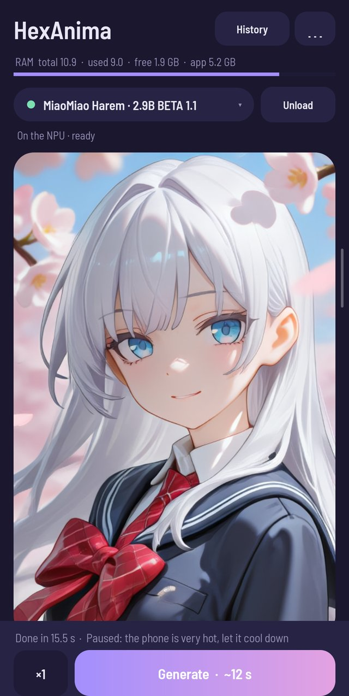
  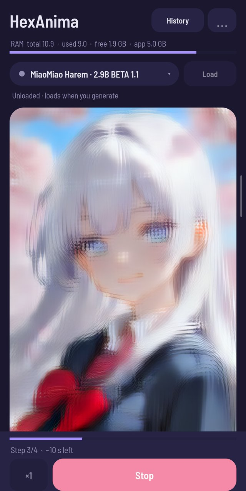
  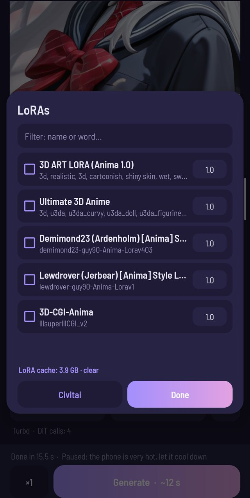
  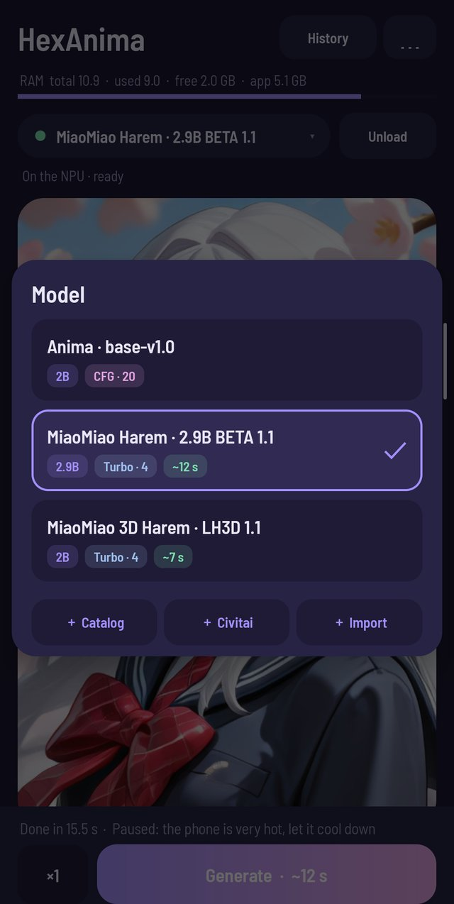

> **All credit for HexAnima goes to [ayanoby](https://github.com/ayanoby).** The NPU kernels, the on-device server, the app and the NPU model packs are their work.
> This fork ports it to the Snapdragon 8 Gen 2 (Hexagon V73) and adds the features listed below. Thank you, ayanoby!

## Download

Get `HexAnima-<version>-v73.apk` from [Releases](../../releases) and install it. If the original HexAnima is installed, uninstall it first: the two are signed with different keys.
Open the app, pick a model, write a prompt and press **Generate**. The models download inside the app (from ayanoby's packs); the V73 text-encoder and VAE files come from [GrimmDev-Glitch/hexanima-packs](https://huggingface.co/GrimmDev-Glitch/hexanima-packs).

*En español:* descarga el APK en [Releases](../../releases), desinstala antes el HexAnima original si lo tienes, abre la app, elige un modelo y genera. La app está en español e inglés.

## Speed (Poco F6 Pro, 512×768)

| Model | Time |
|---|---|
| 2B turbo, 4 steps | ~7 s |
| 2.9B turbo, 4 steps | ~10-12 s |
| 2B non-turbo, 20 steps, CFG 4 (40 NPU calls) | ~85 s |

Times at full speed. Cool mode runs the NPU at a lower clock: about 17 % slower, with the CPU around 60 °C instead of 90 °C on long runs. By default it is automatic: full speed while the phone is cool, the lower clock once the battery reaches 40 °C (43 °C while charging).

## What this fork adds

| | |
|---|---|
| **Snapdragon 8 Gen 2** | NPU kernels rebuilt for Hexagon V73; text encoder (512 tokens) and VAE compiled for V73. |
| **LoRAs** | Write `<lora:name:weight>`, or tick LoRAs in a list with a filter and a weight each: the tag and its trigger words go into the prompt. Formats: kohya, diffusers / ComfyUI, LyCORIS LoKr and LoHa, including the adaLN layers, the LLM adapter and the text encoder (with text-encoder weights the prompt is encoded on the CPU, ~1.4 s). 2B LoRAs also work on 2.9B models. Merged blocks are kept as q8 and cached: 1.3 GB less RAM, and the next load takes ~2 s. LoRAs also work in the low-memory mode. |
| **Civitai** | Search Anima LoRAs and checkpoints, sort, filter, download straight into the app. Optional API key for 18+ (sent only to civitai.com). |
| **Your own checkpoints** | Any Anima `.safetensors` checkpoint becomes an NPU model on the phone. |
| **Live preview** | The picture appears while it is drawn (every step; every 2nd or 4th on long runs), with the step and the seconds left. |
| **Prompt tools** | Tag palette (quality, framing, lighting, style, expression, background), `( − ) ( + )` for `(tag:1.2)` weights, a negative prompt with Clear and Default. |
| **Sampling** | Steps, CFG, 21 samplers, 9 schedulers; saved per model. |
| **Extras** | img2img, **inpainting** (paint a mask), hires fix on the NPU, ADetailer for faces, presets, a queue, a **2×2 comparison grid** (seeds, CFG or steps). |
| **History** | Filter by model, LoRA or prompt words; *Reuse settings* brings back the sampling too. |
| **Heat and memory** | Automatic cool mode, a free-RAM check before loading, and batches that wait for the phone to cool down. A home-screen widget shows free RAM and frees it. |
| **Look** | Lavender light / dark themes, Barlow Semi Condensed font, folding sections. Spanish and English. |

## Screens

<table>
<tr>
<td align="center" width="33%">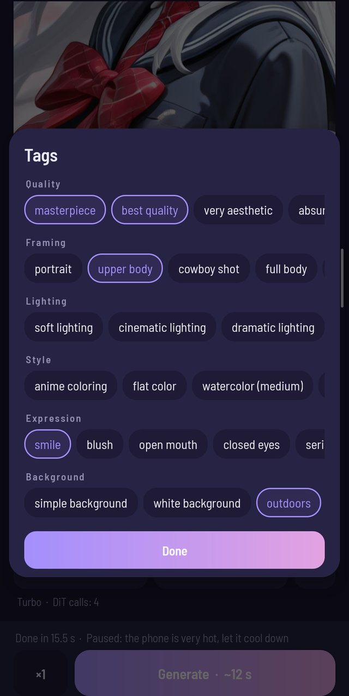 <b>Tag palette</b></td>
<td align="center" width="33%">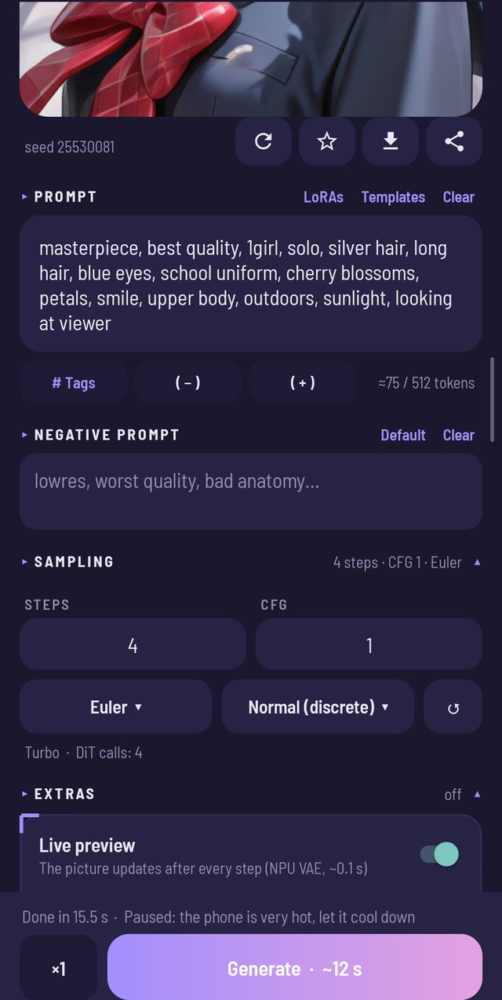 <b>Sampling</b></td>
<td align="center" width="33%">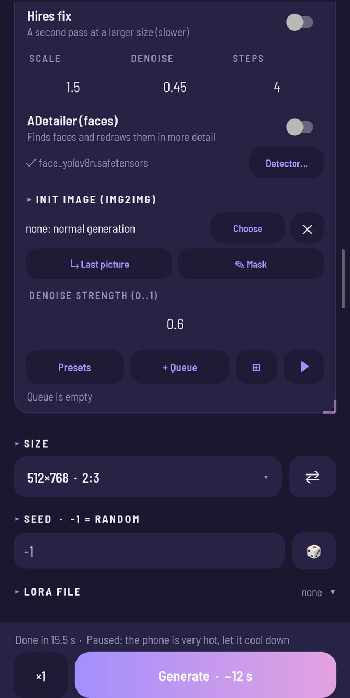 <b>Extras</b></td>
</tr>
<tr>
<td align="center">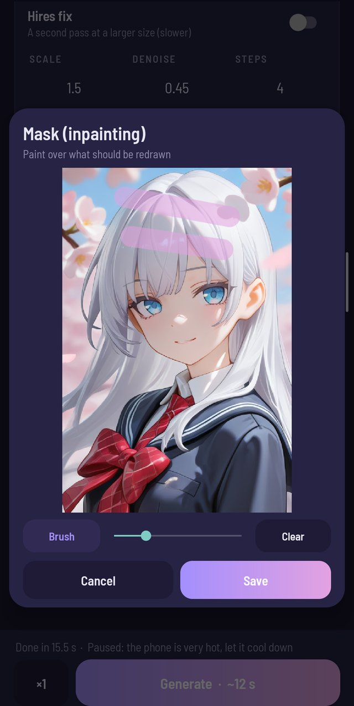 <b>Inpainting mask</b></td>
<td align="center">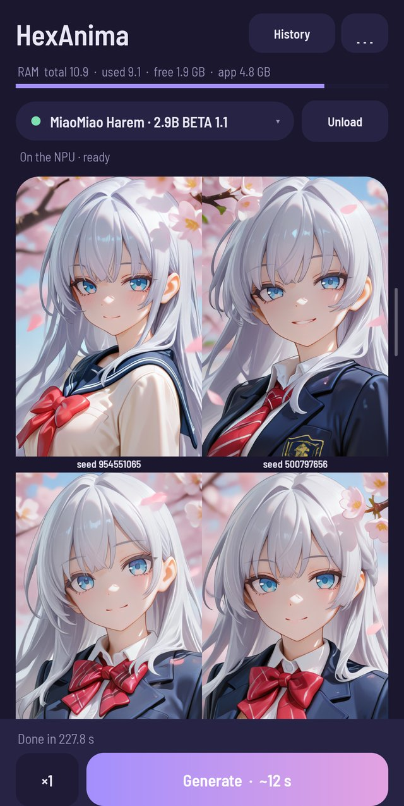 <b>Comparison grid</b></td>
<td align="center">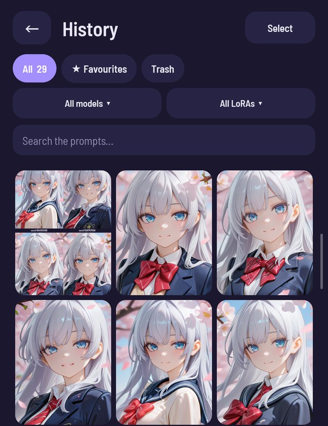 <b>History with filters</b></td>
</tr>
<tr>
<td align="center">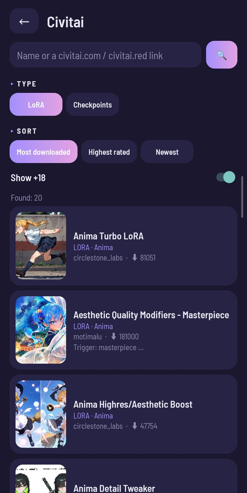 <b>Civitai</b></td>
<td align="center">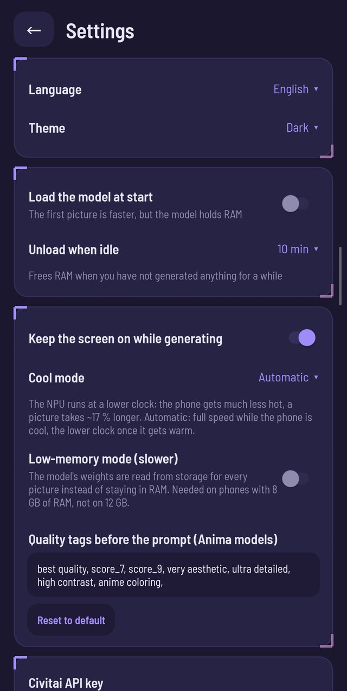 <b>Settings · cool mode</b></td>
<td align="center">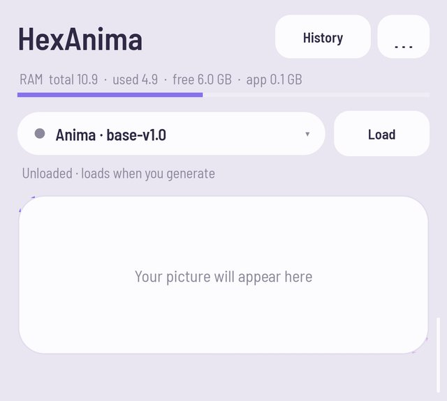 <b>Light theme</b></td>
</tr>
<tr>
<td align="center">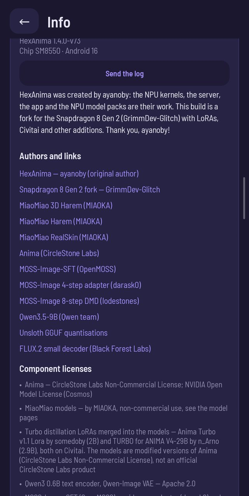 <b>Info · credits to ayanoby</b></td>
<td align="center">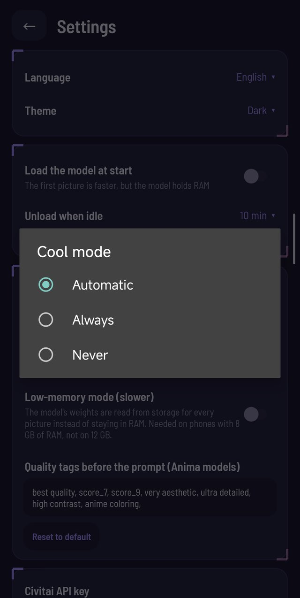 <b>Cool mode: Automatic / Always / Never</b></td>
<td align="center">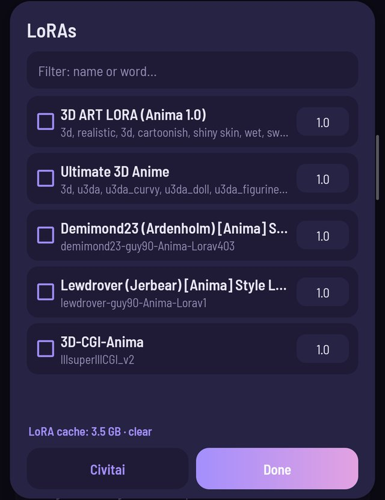 <b>LoRA library · q8 cache size</b></td>
</tr>
<tr>
<td align="center" colspan="3">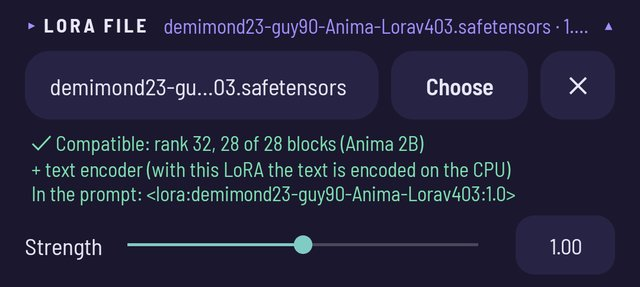 <b>A LoRA with text-encoder weights: applied, the prompt is encoded on the CPU</b></td>
</tr>
</table>

## Requirements

- **Snapdragon 8 Gen 2** (SM8550), tested on a Poco F6 Pro with 12 GB. The Snapdragon 8 Gen 1 / 8+ Gen 1 path of the original app still works; other chips are not supported.
- Android 10 or newer, no root. About 1.2 GB for the shared files plus 3.6-4.2 GB per model.
- MOSS-Image and Qwen-Image (from the original app) do not run on the 8 Gen 2 yet and are hidden there.

## Credits and thanks

- **[ayanoby](https://github.com/ayanoby)**: author of [HexAnima](https://github.com/ayanoby/hexanima), its Hexagon HMX kernels, the on-device server, the app and the [NPU model packs](https://huggingface.co/ayanoby/anima-npu-packs). This fork stands entirely on that work.
- **Models**: Anima by CircleStone Labs (on NVIDIA Cosmos); MiaoMiao Harem / 3D Harem / RealSkin by MIAOKA; turbo LoRAs by somedoby (2B) and n_Arno (2.9B). Non-commercial use only.
- **Software**: [stable-diffusion.cpp](https://github.com/leejet/stable-diffusion.cpp) (patched), Qualcomm QNN runtime, face_yolov8n (Bingsu/adetailer) for ADetailer, Barlow Semi Condensed font (SIL OFL).
- LoRAs you download stay under their authors' licenses.

## Disclaimer

HexAnima is an independent, unofficial project, not affiliated with CircleStone Labs, NVIDIA, Qualcomm, Alibaba (Qwen), OpenMOSS, Civitai or the model authors. "Snapdragon" and "Hexagon" are trademarks of Qualcomm.
The APK includes the Qualcomm AI Engine Direct (QNN) runtime libraries under the Qualcomm AI Stack License, redistributed only as part of the app; the license texts are in `app/assets/licenses/` and in the app (Info → Licenses).
A model author can ask for removal of their model from the download catalog.

## Build

Android SDK (build-tools 34), Docker, the Qualcomm QNN SDK (QAIRT 2.28) and the Hexagon SDK. Build the native parts (`phone/build.sh`, `chainrun/build.sh`, `hexagon/mega/build.sh` with `ARCH=v73` and `v69`, `hexagon/mega/build_megarun.sh`, `android/build_sd.sh`), stage them with `tools/stage_jnilibs.sh`, then `app/build.sh`.
V73 QNN contexts: `tools/build_ctx.sh v73`. Engineering notes: `docs/PITFALLS.md`.

## License

Source code: MIT (`LICENSE`), as in the original project. Models, QNN and other components keep their own licenses: see `THIRD_PARTY.md`.
