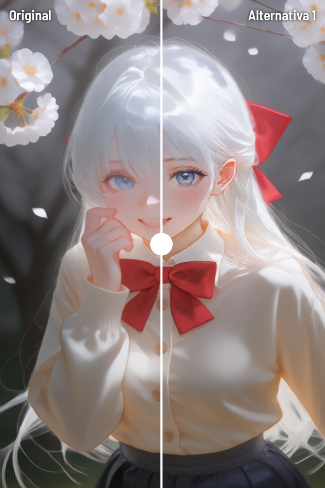

**HexAnima is the work of [ayanoby](https://github.com/ayanoby/hexanima)**: the NPU kernels, the on-device server, the app and the NPU model packs. This fork ports it to the **Snapdragon 8 Gen 2**. Thank you, ayanoby!

**Install:** download `HexAnima-1.7.1-v73.apk` and install it over 1.6.0-v73 or 1.7.0-v73. Your models, LoRAs and pictures are kept.
Coming from 1.5.x-v73 or older? Those were signed with another key: save your pictures (History → ZIP), uninstall, install this one and download the models again.

### New in 1.7.1-v73

**Corrections → Face**
- Face is no longer "coming later". Paint the face (or only the eyes or the mouth) and Qwen-Image redraws **only that area**: a clean face with symmetric, detailed eyes, keeping the same art style, hair, skin tone and expression. The rest of the picture stays pixel for pixel.
- An optional text adds what you want (for example: blue eyes, a soft smile).
- About **a minute** per alternative on the Snapdragon 8 Gen 2; needs Qwen-Image installed. Works for anime and for photos. Make a few alternatives and keep the best.

**Fixes**
- With the new Enlarge and Corrections buttons, the ✕ that hides the shown picture could leave the screen. The buttons under the picture now shrink together when they do not fit, so the ✕ is always visible.

### Novedades (español)

**Correcciones → Cara**
- Cara ya está disponible. Pintas la cara (o solo los ojos o la boca) y Qwen-Image redibuja **solo esa zona**: una cara limpia, con ojos simétricos y detallados, con el mismo estilo, peinado, tono de piel y expresión. El resto de la imagen queda igual.
- Puedes añadir un texto opcional (por ejemplo «ojos azules, sonrisa suave»).
- Alrededor de **un minuto** por alternativa; necesita Qwen-Image instalado. Sirve para anime y para fotos.

**Arreglos**
- La ✕ para quitar la imagen mostrada ya no se sale de la pantalla: los botones se achican cuando no caben.

**Instalación:** se instala encima de 1.6.0-v73 o 1.7.0-v73 sin perder nada.

---
Non-commercial use only. The models and LoRAs keep their authors' licenses. Real-ESRGAN: BSD-3-Clause (license text in the app, Info → Licenses).
SHA-256 of `HexAnima-1.7.1-v73.apk`: `847eee92c63f921881584a5480a3e955551a312e839f48c44aca60aebd8c79dd`
