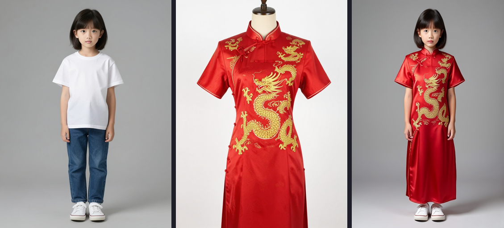

Hi ayanoby, thanks again for pushing the Mage sources and for merging #5!

Following CONTRIBUTING (issue first), here is one idea that touches only your own Mage code, in case it is useful when you come back to it: **Mage edits with several reference pictures** ("the girl from image 1 wearing the dress from image 2"). No PR, just the description and where to find the diff.

**What changes (about 70 lines in `mage/magerun/magerun.cpp`)**
- `edit` reads more pictures from the same folder: `meta.txt` gets one extra line `gh gw rh rw` per picture, with `px1.f32` / `ref1.rgb`, `px2.f32` / `ref2.rgb`. With a single line it behaves exactly as today.
- Text encoder: one `EditImg` per run of `<|image_pad|>` tokens, each with its own ViT features and DeepStack rows. The interleaved mrope counts text tokens one by one, and each merged grid takes `(p, p+row, p+col)`, then `p += max(gh, gw)`. With one picture this gives the same positions as now.
- DiT: the reference latents go one after the other after the target tokens. Reference *k* sits at RoPE frame index *k + 1*, centred like the target. I took this per-image frame index from the public ComfyUI port (wuwukaka/ComfyUI-Mage, `_compute_video_freqs(frame, h, w, idx)`).
- Limit: target + all reference tokens ≤ 6400 (the same 8 MB VTCM budget as now). On the app side I shrink the output and the extra references to fit.

**App side (small)**
- `QwenTok.encodeMageEditMulti(prompt, int[] pads)` writes `Image 1: <|vision_start|>…<|vision_end|>Image 2: …`, the same template the single-picture edit already uses.
- `Mage.prepareEdit(home, photo, extras, prompt, w, h, ids)` writes the extra `px`/`ref` files and meta lines.

**Tested** on the Snapdragon 8 Gen 2 (V73 build of your kernel): image 1 (a girl in a t-shirt) + image 2 (a red dress on a mannequin) → the girl wearing the dress, 768×1024 in **24.4 s** (te + 2 ViTs + 4 DiT steps). The single-picture edit is unchanged.

Diff: https://github.com/GrimmDev-Glitch/hexanima/commit/67f20da (`mage/magerun/magerun.cpp`, `Mage.java`, `QwenTok.java`; the `Main.java` part is my fork's UI).

I have not tested it on V69 (no 8 Gen 1 here), but nothing in the change is V73-specific. Feel free to reimplement it your own way, or to ignore it if it does not fit your plans. Thanks!
